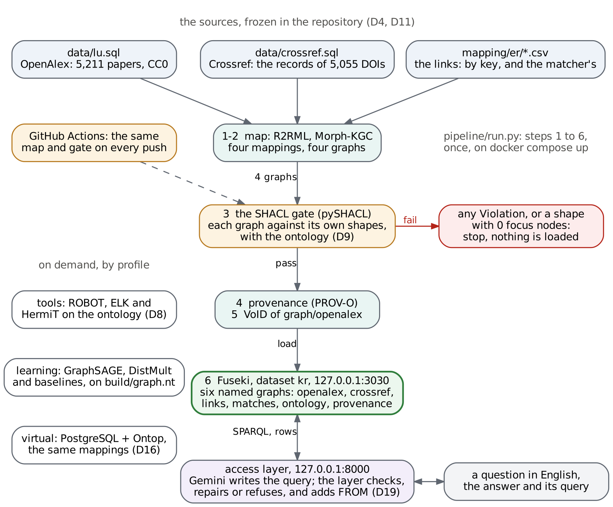

# A knowledge graph of Lebanese University's publications

The Knowledge Representation team project (Lebanese University, MSc, 2026),
by Karam Jammal. This repository holds the knowledge graph of LU's 5,211
publications from 2022 to 2025, as OpenAlex records them (institution
I160368002), checked against Crossref as a second source. On top of the graph:
an OWL ontology aligned with FaBiO and FOAF, SHACL shapes that gate every load,
two models trained on earlier years and tested on a later one, and a page where
a question in English becomes a checked SPARQL query, or a refusal.

The technical report is [report/REPORT.md](report/REPORT.md); every decision,
with its alternative and its evidence, is in
[report/decisions.md](report/decisions.md) (D1 to D21).

## Run it

```sh
cp .env.example .env        # then put a Gemini key after GOOGLE_API_KEY=
docker compose up --build
```

On Windows, with Docker Desktop: `copy .env.example .env` in Command Prompt
(`Copy-Item .env.example .env` in PowerShell), then `notepad .env` to add the
key, then the same `docker compose up --build`.

Nothing else is needed: no OpenAlex or Crossref key and no network for the
data, which is frozen in the repository (`data/lu.sql`, `data/crossref.sql`,
D4, D11).

**Expect** (about 7 minutes after the images are built), the pipeline's lines:

```text
1 source: our data, data/lu.sql, data/crossref.sql and the links of mapping/er
2 map: graph/openalex, 578,982 triples (mapping/mapping.ttl) -> build/graph.nt
2 map: graph/crossref, 341,926 triples (mapping/crossref.ttl) -> build/crossref.nt
2 map: graph/links, 9,293 triples (mapping/links.ttl) -> build/links.nt
2 map: graph/matches, 30,848 triples (mapping/matches.ttl) -> build/matches.nt
3 validate: graph/openalex against shapes/shapes.ttl: 0 Violation, 2,585 Warning, 1,070 Info
3 validate: graph/crossref against shapes/crossref-shapes.ttl: 0 Violation, 780 Warning, 28,182 Info
3 validate: graph/links against shapes/links-shapes.ttl, ...: 0 Violation, 0 Warning, 0 Info
3 validate: graph/matches against shapes/matches-shapes.ttl, ...: 0 Violation, 60 Warning, 0 Info
4 provenance: 140 PROV-O triples -> build/provenance.ttl
5 describe: 1251 VoID triples -> build/void.ttl
6 load: graph/openalex, graph/crossref, graph/links, graph/matches, graph/ontology, graph/provenance -> http://fuseki:3030/kr
done
```

then the pipeline container exits with code 0, and the access layer prints
`the page:   http://127.0.0.1:8000/`.

- **http://127.0.0.1:8000/**: the page. Type a question, or click one of the
  five examples: "How many conference papers are there?" is answered (482),
  "What is the email address of Maha Hoteit?" is refused, with what the graph
  lacks. Under each answer, the query that computed it.
- **http://127.0.0.1:3030/**: Fuseki, dataset `kr`, six named graphs.
- **The TEXT2SPARQL contract**:
  `http://127.0.0.1:8000/?question=How%20many%20papers%20did%20LU%20publish%20in%202024%3F&dataset=https://ul.edu.lb/kr/lu/`

## Check each layer

The stack runs the pipeline and the access layer. The reasoner, the models
and the virtualized route run on demand, from the same checkout, each with one
command. Run these from the repository root while the stack is up.

| Layer | Run | Expect | Evidence in the repository |
|---|---|---|---|
| Ontology | `docker compose --profile tools run --rm reasoner` | ELK and HermiT: consistent, no unsatisfiable classes; our file in OWL 2 DL | `ontology/reasoner-run.txt`, `ontology/competency_questions.md`, `ontology/cq_answers.txt` |
| Shapes and validation | the pipeline's step 3, above; on GitHub, the "SHACL gate" workflow on every push | 0 Violation in all four graphs | `shapes/triage.md` (3,636 Violations triaged to 0), `shapes/*-validation-report.txt` |
| Mapping and integration | the pipeline's step 2, above; `mapping/check_one_paper.py` (in CI) | four graphs mapped; the paper written by hand comes out of the mapping | `mapping/README.md`, `mapping/er/match_authorships.txt` (precision 0.9997, recall 0.9995), `mapping/ontop/compare-routes.txt` |
| Learning | `docker compose --profile learning run --rm model` (CPU; about half an hour, more on a laptop) | rewrites `model/results/`; `git diff model/results` shows how far a new computer's numbers move | `model/README.md`, `model/results/` |
| Access layer | `docker compose exec -e LLM_MODE=replay access-layer python evaluate.py` | the recorded score, replayed without a key: mean F1 0.750 in the deployed setting, 4 of 4 refused | `access-layer/README.md`, `access-layer/results/score-*.txt` |
| Report | | | `report/REPORT.md`, `report/decisions.md` |

The virtualized route (Ontop over PostgreSQL, D16) needs `POSTGRES_PASSWORD`
in `.env` and four commands, listed in `mapping/README.md`.

Without Docker (Python 3.12, from the repository root), the pipeline runs on
its own, as CI runs it:
`pip install -r pipeline/requirements-pipeline.txt`,
`pip install --no-deps morph-kgc==2.10.0`, then
`python pipeline/run.py --no-load`.

## What goes where

| Folder | Layer | Session | What it holds |
|---|---|---|---|
| `data/` | the sources | 1, 5 | OpenAlex (`lu.sql`, 8 tables) and Crossref (`crossref.sql`, 4 tables), frozen; the scripts that made them; the profile and the constraint inventory |
| `ontology/` | the ontology | 3 | `ontology.ttl` (version 1.1.0, OWL 2 DL, aligned with FaBiO, FOAF, PRO, CiTO), local copies of the imports, the 10 competency questions and their answers |
| `shapes/` | SHACL | 4 | the shapes of each graph, the triage, the validation reports |
| `mapping/` | R2RML and entity resolution | 2, 5 | four mappings (one per graph), the hand-written paper and its test, `er/` (the links between the sources), `ontop/` (the virtualized route) |
| `pipeline/` | map, gate, provenance, describe, load | 4, 5 | `run.py`, the PROV-O record of each run |
| `fuseki/` | the endpoint | 2 | Fuseki 5, one TDB2 dataset, the default graph the union of the named graphs |
| `reasoner/` | ELK and HermiT | 3 | ROBOT, on demand |
| `model/` | learning | 6 | the field of a paper, new co-authorships, their baselines and results |
| `access-layer/` | questions in English | 7 | the layer, its page, its test set and its recorded score |
| `report/` | the report | all | `REPORT.md`, `decisions.md`, `figures/` |
| `.github/workflows/` | CI | 4 | the SHACL gate on every push |



The endpoint is only ever loaded with data that passes the gate: change one
value in `data/lu.sql` so a paper has a year of 2030, run the pipeline again,
and it stops at step 3 and says why.

## Rules kept

- Every port listens on 127.0.0.1 only. The Gemini key, and the PostgreSQL
  password of the virtualized route, live only in `.env`, which is never
  committed (`.gitignore`, `.dockerignore`).
- Each question typed on the page is sent to Google's Gemini with the graph's
  description, never the data; on the free tier Google may use what it
  receives, so ask only about this graph.
- Every reused ontology, vocabulary and dataset, with its licence:
  `ontology/LICENCES.md` and the report's licence table. OpenAlex data is CC0.
