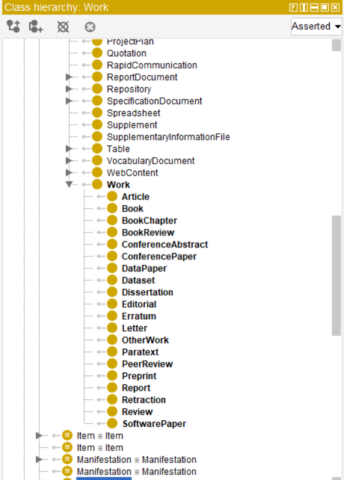
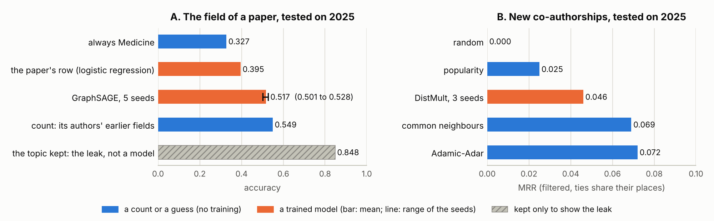
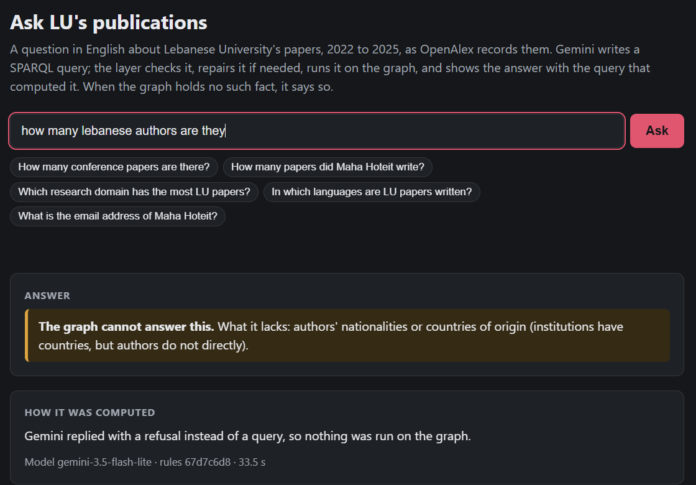

# Technical report: a knowledge graph of Lebanese University's publications

Karam Jammal · Knowledge Representation (MSc), Lebanese University · October 2026 ·
repository karam294/krr-lu-publication

This project builds a knowledge graph of the papers that Lebanese University
(LU) published between 2022 and 2025, as OpenAlex records them: 5,211 papers
and 33,084 authorships, with the institutions, venues and topics around them.
I used Crossref as a second source, to check OpenAlex wherever the two
overlap. On top of the graph there is an OWL ontology aligned with FaBiO and
FOAF, a SHACL gate that has to pass before anything is loaded, two prediction
tasks that are tested on a later year than the one they were trained on, and a
small web page where you can ask a question in English and get the answer
together with the SPARQL query that produced it, or a refusal when the graph
does not hold that kind of fact.

The report describes the system as it is deployed in the repository, not as
it was planned. Every number I quote comes from a file in the repository, and
I name the file next to it. The decisions I refer to (D1 to D21) are written
out in `report/decisions.md`, each with the alternative I considered and the
evidence that decided it.

## 1. Problem framing and scope

**The questions.** I started from ten competency questions, written before the
ontology (`ontology/competency_questions.md`). They come from three kinds of
users: LU's research office (R), a researcher or a dean (D), and the project
itself (P), for questions about the quality of the data. Each question is a
SPARQL file in `ontology/cq/`, and `ontology/run_cqs.py` writes the answers to
`ontology/cq_answers.txt`. This is what makes them measurable: every question
has an answer on the graph, and anyone can run it again.

| # | Asked by | The question, in short | The answer on the graph (cq_answers.txt) |
|---|---|---|---|
| CQ1 | R | papers per year, by type, open access | 1,272 papers in 2022, up to 1,431 in 2025; open access from 898 to 1,102 |
| CQ2 | D | who publishes most, and as first, last or corresponding author | Pascale Salameh, 283 papers, 109 of them as last author |
| CQ3 | R | which countries and institutions LU co-authors with | CNRS (France) on 659 papers, then the Lebanese American University on 495 |
| CQ4 | R | where LU publishes | 2,028 journals carry 4,085 papers; 103 conferences carry 212 |
| CQ5 | R | research fields and domains, by year | Health Sciences is first every year, 436 papers in 2022 and 543 in 2025 |
| CQ6 | D | LU papers citing LU papers | 2,116 citations; the most cited paper is cited 22 times |
| CQ7 | R | languages | English 4,748, French 114, Arabic 88 |
| CQ8 | R | retractions | OpenAlex flags 6; Crossref has a notice retracting 2 of them, and says 2 others are notices themselves |
| CQ9 | P | authorships with no identified person, shared ORCIDs | 2,101, down to 1,790 after the ORCID links, and 1,449 of those matched |
| CQ10 | P | does Crossref agree on the title, year and venue? | the same title for 4,882 of 4,887 pairs, the same year for 4,697 |

Apart from these SPARQL queries, the graph has two other users: the access
layer, which turns a question in English into a query (section 7), and the
learning layer, which predicts the research field of a paper and new
co-authorships (section 6).

**Scope.** The data is every OpenAlex work with an LU affiliation (institution
I160368002) published from 2022 to 2025, downloaded on 2026-10-16, plus the
Crossref record of each of the 5,055 distinct DOIs among them, downloaded on
2026-10-19. Both downloads are frozen in the repository as SQL files (D4, D11).
I did this so that a clean checkout grades exactly the data this report talks
about: a new download would give different numbers, because OpenAlex changes
every day.

**What I left out, and why.**

- *OpenAlex's xpac records* (repository copies and DataCite datasets).
  OpenAlex itself says they are of lower quality, and they would add
  near-duplicates. With them, 2024 would have 1,398 papers instead of 1,288 (D1).
- *Abstracts.* They are the one part of Crossref's metadata that can be under
  copyright (`ontology/LICENCES.md`), and none of my questions needs them.
- *Citation counts, funding, contact details, nationality, students.* None of
  my sources holds these, so the access layer refuses questions about them
  (section 7).
- *Facts that change over time.* An author's affiliation is the one printed on
  a given paper (an authorship), never a permanent fact about the person.

## 2. Data understanding and constraint discovery

**The sources.** OpenAlex is an open index of scholarly works, published under
CC0. Its API returned 5,211 papers, which `data/build_table.py` split into 8
tables and `data/build_database.py` froze as `data/lu.sql` (21.7 MB, D4).
Crossref is where publishers register their DOIs. It found 4,886 of our 5,055
DOIs; the other 169 are registered elsewhere, mostly with DataCite (112 on
Zenodo, 26 on arXiv, `data/profile/build_crossref.txt`). Crossref states that
almost none of its metadata is under copyright, except some abstracts, which I
do not keep.

**What one row means** (`data/README.md`). Getting the grain right shaped the
whole graph. A row of `authorships` is one author on one paper, so an
authorship became a node of its own (pub:Authorship). It carries what is true
only on that paper: the position in the byline, the name as it was printed, and
the affiliations the author gave.

| Table | One row is | Rows |
|---|---|---:|
| works | one paper | 5,211 |
| authorships | one author on one paper | 33,084 |
| affiliations | one institution of one authorship | 51,737 |
| authors | one OpenAlex author | 14,090 |
| institutions, sources, topics | one institution, one venue, one topic | 3,656, 2,216, 1,610 |
| citations | one paper citing another | 175,896 |
| Crossref: cr_works, cr_authors, cr_references, cr_updates | one record, author, reference, notice | 5,055, 35,468, 149,936, 63 |

**What the profile showed** (`data/profile/profile_tables.txt`). Names are not
keys: 14,090 authors share 13,955 distinct names. DOIs and ORCIDs are almost
keys, but not quite: 5,057 DOIs with 5,055 distinct, and 9,081 author records
with an ORCID but only 9,061 distinct ORCIDs. So I named every thing by its
source's own identifier, never by a name or a DOI (D3):
`https://ul.edu.lb/kr/id/{kind}/{source}/{key}`.

**The constraint inventory** (`data/constraint_inventory.csv`). I wrote down ten
rules I expected the data to follow, each with the evidence for or against it.
Eight of them turned out to be false in the data. I kept them and reported
them rather than dropping them; section 4 explains what the shapes do with each.

| Rule | Evidence | Holds? |
|---|---|---|
| Exactly one author is labelled first, and it is at order 1 | no exception in 5,211 papers | yes |
| At most 100 authors per paper | 19 papers have exactly 100, the OpenAlex cap | yes, but the cap cuts some bylines |
| Every LU paper lists an LU author | 6 do not: all 6 list 100 authors, so the LU author was cut off | no |
| A DOI identifies one paper | 2 DOIs each appear on two records of the same paper | no |
| An ORCID identifies one author record | 20 ORCIDs appear on two records | no |
| Every authorship has an author ID | 2,101 of 33,084 have none (6.4%) | no |
| Every paper has a topic, a venue, a DOI | 12, 214 and 154 papers have none | no |
| Every paper's reference list is recorded | 1,051 papers have none (20%) | no |

## 3. Ontology

**What I reused, and why.** The ontology (`ontology/ontology.ttl`) defines 26
classes, 7 object properties and 23 datatype properties of my own, under the
prefix pub:. I aligned it with the SPAR ontologies, which are the published
vocabularies for bibliographic data: FaBiO 2.3.1 with FRBR 1.1.0, CiTO 2.9.0 and
PRO 1.6.1, plus FOAF and Dublin Core (D7). FaBiO and FOAF are imported from
local copies (`ontology/imports/`, found through `catalog-v001.xml`), so the
reasoner checks my axioms together with theirs. The data itself keeps the pub:
terms. Writing FaBiO's terms directly into the data would have meant rewriting
the mapping and its test, without adding any meaning, since the alignment
already says the same thing once, in the ontology.

**How I aligned it.** I followed one rule: a pub: term goes under a published
one (rdfs:subClassOf or rdfs:subPropertyOf) only when the meaning, the domain
and the range all agree. When they don't, I link the two with skos:closeMatch.

| Mine | Relation | Published |
|---|---|---|
| pub:Work, and its 20 kinds (Article, Review, ConferencePaper, Preprint, ...) | subClassOf | fabio:Expression; fabio:Article, fabio:ReviewArticle, fabio:ConferencePaper, fabio:Preprint, ... |
| pub:Author, pub:Institution | subClassOf | foaf:Person, foaf:Organization |
| pub:Authorship; pub:hasAuthorship, pub:author, pub:affiliation | subClassOf; subPropertyOf | pro:RoleInTime; pro:isDocumentContextFor, pro:isHeldBy, pro:relatesToOrganization |
| pub:cites, pub:title, pub:hasTopic | subPropertyOf | cito:cites, dcterms:title, fabio:hasSubjectTerm |
| pub:Dataset, pub:Report, pub:Erratum, pub:PeerReview, pub:BookReview | closeMatch | fabio:Dataset, fabio:Report, fabio:Erratum, fabio:Review, fabio:BookReview |
| pub:publicationYear, pub:language, pub:name | closeMatch | fabio:hasPublicationYear (an xsd:gYear), dcterms:language (not a text value), foaf:name (not meant for topics) |

The closeMatch rows were decisions, not gaps. FaBiO puts datasets, reports,
reviews and errata at FRBR's Work level, but an OpenAlex work is an
Expression, and FRBR makes Work and Expression disjoint. My first version said
`pub:Dataset rdfs:subClassOf fabio:Dataset`, and both reasoners found
pub:Dataset unsatisfiable (D8). That is why it became a closeMatch. pub:Venue
has no superclass at all, because FaBiO splits venues by kind while OpenAlex
gives a single "source" with a type.

**Every term answers a competency question.** Each class and property carries
the annotation pub:answersCQ, and `ontology/competency_questions.md` lists the
question behind every term. A term with no question gets deleted. For example,
pub:Authorship exists because of CQ2 (being first, last or corresponding author
is a fact about one paper, not about the person) and CQ3 (the affiliation is
the one given on that paper).

**The OWL profile and the reasoner run** (D8, `ontology/reasoner-run.txt`). The
file is in OWL 2 DL. It would fit OWL 2 EL except for its xsd:boolean and
xsd:date ranges, which I kept because they say what the values are. ROBOT 1.9.10
runs two reasoners, ELK (fast, EL only) and HermiT (complete), in a container
that runs on demand (`docker compose --profile tools run --rm reasoner`). Both
find the ontology consistent, with no unsatisfiable class. My own file passes
ROBOT's OWL 2 DL check. With the imports, 976 violations remain: 4 concern
Dublin Core terms that my file uses and FaBiO declares differently, and the rest
are inside FaBiO itself.

**The version.** The ontology IRI is `https://ul.edu.lb/kr/pub` and the version
IRI is `https://ul.edu.lb/kr/pub/1.1.0`, with owl:priorVersion 1.0.0. Version
1.1.0 added three terms for Crossref (pub:updates, pub:venueName and pub:issn,
D14). Adding a term is a minor version; removing a term or changing its meaning
would be a major one (`ontology/README.md`). Every pipeline run records which
version it loaded (section 8).

**What stays out of OWL.** Domains and ranges add types; they never reject
data. Rules about what the data must contain belong in the shapes (section 4).

## 4. Constraint validation with SHACL

**Why SHACL for the data and OWL for the meaning.** OWL reasons in an open
world. A missing DOI is simply unknown, never an error. And a "max one" rule
makes the reasoner conclude that two papers sharing a DOI are the same paper,
without telling anyone. SHACL checks the graph we actually have, and it lists
the nodes that need fixing. So every rule of the inventory became a shape
(`shapes/README.md` gives the reason rule by rule):

| Rule | Shape | Severity | Why SHACL and not OWL |
|---|---|---|---|
| One first author, at order 1 | PaperShape, qualified value shapes | Violation | it counts authorships with a given value; OWL's qualified cardinality never reports a paper that has none |
| An LU author, unless the byline is cut at 100 | LUAuthorShape, sh:or, a path of two steps | Violation, and a Warning for the 6 | in OWL, "at least one" is satisfied by an unknown author |
| A DOI, or an ORCID, identifies one record | `^pub:doi`, `^pub:orcid`, max 1 | Warning | owl:hasKey would merge the two records and report nothing |
| A topic, a venue, a DOI, an author ID | min 1 | Warning | to OWL, a missing value is just unknown |
| A paper does not cite itself | SPARQL constraint | Warning | an irreflexive property would make the whole graph inconsistent because of 75 errors |
| The last author has the highest order | SPARQL constraint | Violation | it compares a node with other nodes |
| One class of the 20; a year from 2022 to 2025; booleans, value lists, IRIs of my scheme | core | Violation | these are checks on values; an OWL range only adds a type |

The shapes use the ontology's rdfs:subClassOf, so `sh:targetClass pub:Work`
checks all 20 kinds of paper. The two layers really work on the same graph.

**Triage** (`shapes/triage.md`). In the first draft (`shapes/shapes-v0.ttl`)
every rule was a Violation, and it gave 3,636 Violations on the whole graph. I
went through the report group by group and asked the same question each time:
*is the rule wrong, or is the data wrong?* Each group then got one of three
decisions: change the rule, fix the source, or accept the problem for now as a
Warning, with a TRIAGE comment in `shapes.ttl` that says why and until when. I
did not delete any rule just to make the report green.

| Results | Rule | Rule or data? | Now |
|---:|---|---|---|
| 2,101 | an authorship has an author ID | the source is incomplete; Session 5 linked 311 of them by ORCID | Warning |
| 1,051 | a reference list is recorded | wrong for errata and peer reviews, incomplete for the rest | Info |
| 214, 154, 12 | a venue, a DOI, a topic | the source is incomplete | Warning |
| 75 | no self-citation | wrong at the source; Crossref confirms only 4 (cq06_sources) | Warning |
| 20, 2 | one record per ORCID, per DOI | wrong at the source; linked as one in graph/links | Warning |
| 6 | an LU author | **the rule was wrong**: it ignored the cap of 100 authors | a new rule, still a Violation |
| 1 | a retraction notice is not retracted | wrong at the source (W4415060141) | Warning |

After triage, the OpenAlex graph gives **0 Violations, 2,585 Warnings and 1,070
Info** (`shapes/validation-report.txt`). The other three graphs have their own
shapes, because the OpenAlex rules don't hold for them: a Crossref record can
list 1,512 authors, and it has no open-access flag. Their results are 0
Violations, 780 Warnings and 28,182 Info for Crossref, no result at all for the
links by key, and 0 Violations with 60 Warnings for the matcher's links (D14,
D15). The severity decides what the pipeline does: a Violation stops it, a
Warning is a known problem of the source, and an Info is a coverage figure.

**The gate.** `pipeline/run.py` validates each graph whole (578,982 triples for
OpenAlex, with the ontology), not a sample, because a sample could miss the one
bad row (D9). It stops before the endpoint on any Violation, and also on any
shape that has 0 focus nodes: a shape that targets nothing passes forever, and
that is exactly what the template's order shape did on my graph from Session 2
to Session 4. The same steps, plus the mapping's test (section 5), run on GitHub
Actions on every push and every pull request (`.github/workflows/shacl-gate.yml`).

**A red run that the gate blocked.** In pull request #N (branch
`demo/red-gate`) I changed one value in `data/lu.sql`, the year of paper
W3023054831, from 2022 to 2030, the way a bad row from a new download would
arrive. The gate found exactly 1 Violation ("Every paper · MaxInclusive on
publicationYear: a paper has one publication year, from 2022 to 2025"), the run
failed, and I closed the pull request without merging it. Run locally, the same
change stops the pipeline at step 3 with "SHACL gate: graph/openalex: 1
Violation. The endpoint is not loaded."

**What it cost, and what it does not check.** pySHACL runs a SPARQL rule once
for each focus node. The last-author rule took 330 s of a 395 s run, until I
moved the constant "last" into the FILTER (118 s, same answer). Some things are
deliberately not checked: a wrong language code (9 papers marked `lv`) is still
a well-formed code; a paper citing a later paper is normal with online-first
publishing; and 98 institutions have no country, which no question needs. There
is also a cost to using Warnings: a 21st shared ORCID would not stop the gate,
although the counts in the report would show it.

## 5. Operational data integration

**The mapping.** There are four R2RML mappings, one per named graph:
`mapping/mapping.ttl` (OpenAlex, 578,982 triples), `crossref.ttl` (341,926),
`links.ttl` (9,293) and `matches.ttl` (30,848), all run by Morph-KGC 2.10.0.
Before writing the mapping, I wrote one paper, W3023054831, by hand
(`mapping/one_paper_by_hand.ttl`, 81 triples), and `mapping/check_one_paper.py`
checks in CI that the mapping produces every one of those triples. The two
sources keep separate nodes: an OpenAlex paper is `.../work/openalex/W...` and
its Crossref record is `.../work/crossref/{DOI}`. They only become one paper
through a link, after checking (D3).

**Materialized or virtualized?** (D16, `mapping/ontop/compare-routes.txt`). I
also ran the same four mappings virtualized, with Ontop 5.5.0 answering SPARQL
directly from the tables in PostgreSQL, and `compare_routes.py` asked both
routes every competency question.

| | Materialized (deployed): Morph-KGC, SHACL, Fuseki | Virtualized: Ontop over PostgreSQL |
|---|---|---|
| Freshness | a change shows after the next pipeline run (the last one took 5 min 8 s) | a change shows at the next query, without any check first |
| Latency | seconds, for every question | seconds, for the 12 it can answer |
| Workload | all 16 queries | 12 of 16: an EXISTS form and three CQ10 queries fail |
| The graph | 961,049 triples | 961,049; 707 differ only in how a non-ASCII DOI is encoded |

The deployed system materializes. Freshness is not an argument for Ontop here:
my sources are frozen downloads (D4, D11), and anything Ontop showed
immediately would not have passed the SHACL gate, which needs a stored graph.
Latency doesn't decide either. What decides is the workload: the access layer
sends queries written by a model, which can use property paths (`*`, `+`) that
Ontop doesn't support, and the learning layer reads the whole graph. The
comparison was still worth it. The 707 different triples turned out to be
reference DOIs with a typographic hyphen, which no shape had noticed (it is a
Warning now), and one view needed a name before it could run on both engines.

**Entity resolution** (`mapping/er/README.md`). The first part links records
that share an identifier, so there is no guessing (`link_by_key.txt`): 4,887
OpenAlex papers to the Crossref record of their DOI; the 2 pairs of OpenAlex
records of the same paper and the 20 pairs of the same person; 311 authorships
without an author ID, through their ORCID (D12); and 3,827 author records to the
Crossref person with the same ORCID. The second part matches authors, who
share no identifier between the sources. It follows Fellegi and Sunter:
blocking on the paper (962,298 pairs), three compared fields (the name, the
first initial, the position in the byline), and weights log2(m/u). The m and u
values are *counted*, on half A of the papers, from the pairs where both sides
carry an ORCID; the ORCID itself is never a field of the matcher. Then each
author is matched at most once per paper, and a link is kept from a score of 4
(D13).

| Measured on half B: 3,681 Crossref authors whose true match is known by ORCID | Precision | Recall |
|---|---:|---:|
| threshold 4 (deployed), 30,848 links over all papers | 0.9997 | 0.9995 |
| threshold 8 | 0.9997 | 0.9957 |
| the position alone | 0.9910 | 0.9908 |

ORCID labels only exist when both sources have an ORCID, which are the easy
cases. So I also checked 40 links by hand where that is not true
(`hand_sample.csv`): 19 of the 20 links scored between 4 and 8 are the same
person, and so are 17 of the 19 scored above 8 whose names are not obviously
equal. One weakness remains, and I measured it: when the family name and the
position agree, a different first initial does not cancel the link (28 links;
2 of the 4 I checked are two different people). The matcher's shapes also flag
the 52 links where the two sources give the person two different ORCIDs.

**The links in the graph** (D15). The links are owl:sameAs statements in two
named graphs: graph/links (by identifier) and graph/matches (guessed, with a
measured precision). The records are never merged, so each triple still says
which source it came from, and a wrong link can be removed without touching a
source. A query decides how sure it needs to be; CQ9 counts with both. The
integration also taught me things about the data: Crossref confirms only 4 of
the 75 self-citations, it names a venue for 105 papers that have none in
OpenAlex, and it shows that one "retracted article" is actually itself a
retraction notice (W4308586991, cq08_sources).

## 6. Prediction and evaluation honesty

**The graph the models see** (`model/build_graph.py`,
`model/results/build-graph.txt`). It is read from graph/openalex with SPARQL:
5,211 papers, 14,090 authors, 2,216 venues and 3,656 institutions, with the
edges author writes paper (30,904), paper publishedIn venue, paper cites paper
(LU to LU, 2,116) and paper withInstitution institution. A paper's features are
only what is known on the day it is published: its kind, its language, open
access, and its number of authors. The other nodes have no features; the
models learn a vector for each of them.

**Two tasks, both split by time** (D17, D18). Since every paper has a year,
every model is trained on the past and tested on the future, in two rounds: a
validation round (train on 2022 to 2023, test on 2024), where all settings are
chosen, and a test round (train on 2022 to 2024, test on 2025), run with those
settings, which is the result I report. The settings are chosen by the run
itself (`--settings`), which writes its choice on the last line of a results
file, and the models read it from there. I did it this way because two
computers ranked the settings differently, and settings typed into the code
would have contradicted their own evidence.

- *Node classification: the research field of a paper* (26 OpenAlex fields).
  The label is the field of the paper's topic, so I removed the topic from the
  graph: no topic nodes and no hasTopic edges. The models are: always guess
  the largest field; a logistic regression on the paper's own row; a count of
  its authors' earlier fields; and GraphSAGE (PyTorch Geometric, to_hetero),
  with the best of 16 settings on 2024 and five seeds.
- *Link prediction: new co-authorships.* For each pair of authors who first
  write together in the test year, the right partner is ranked, in both
  directions, among all authors who had a co-author before that year (about
  9,100 candidates in 2025). The ranking is filtered, and tied candidates
  share the middle of their places. This matters because with a count,
  thousands of candidates tie at 0, and the right one's rank should not depend
  on the order of a list. The models are random, popularity, common neighbours,
  Adamic-Adar, and an embedding (PyKEEN) of the knowledge graph of the earlier
  years: DistMult of dimension 128, the best MRR of six on 2024, with three seeds.

| 2025 | Score | Spread over the seeds |
|---|---|---|
| field: the topic kept, a lookup (the leak) | accuracy 0.848; 1.000 on the 78% whose topic it has seen | |
| field: the paper's own row (logistic regression) | accuracy 0.395, macro-F1 0.139 | |
| field: count of the authors' earlier fields | **accuracy 0.549**, macro-F1 0.350 | none, it is a count |
| field: GraphSAGE | accuracy 0.517, macro-F1 0.341 | 0.501 to 0.528; macro-F1 0.306 to 0.360 |
| co-authors: Adamic-Adar | **MRR 0.072**, Hits@10 0.169 | none |
| co-authors: DistMult | MRR 0.046, Hits@10 0.101 | MRR 0.046 for all three; Hits@10 0.100 to 0.103 |

**Why the split does not leak.** The test papers and pairs did not exist when
the models were trained, the source of the label (the topic) is not in the
graph, and nothing is tuned on 2025. The leak line shows what I avoided: with
the topic kept, a simple lookup is right on every paper whose topic it has
already seen.

**Both models lose to a count, and that is the result.** The graph does help:
the paper's own row gets 0.395, while using its neighbours gives 0.517 to
0.549. That is because 81% of the 2025 papers share an author with an earlier
paper, and authors tend to stay in their field. But counting the authors'
earlier fields, which is one step of label propagation, beats GraphSAGE, which
sees its neighbours' features but never their labels. Huang et al. (2021)
found the same thing on standard benchmarks. For co-authorships, Adamic-Adar
beats the embedding on every score in 2025. On the half of the new pairs that
share no earlier co-author, the counts are blind (MRR 0.000); there popularity
does best (0.017), not the embedding (0.006 to 0.007). On 2024 the embedding
was ahead only on Hits@100 (0.469 to 0.480, against 0.448). I report this as
it came out, instead of tuning on 2025 until the models win.

**What the numbers do not show** (`model/README.md`). The label is itself the
output of a model: OpenAlex assigns topics from a paper's title, abstract,
citations and journal name, so part of what my models learn is OpenAlex's own
rule. Titles are left out on purpose, to measure what the graph adds. One test
year is only one draw, and on another computer the embeddings can move by up to
0.02 in MRR. Finally, the predictions are not loaded into the knowledge graph:
they are guesses that no shape can check, and a query on the default graph
would count them as facts (D21).

## 7. Access layer

**Grounding.** Gemini (gemini-3.5-flash-lite, temperature 0) writes one SPARQL
query from a prompt that the layer builds (`access-layer/access_layer.py`). The
prompt contains the rules (`prompt_rules.txt`: how my graph names things, and
when to refuse), the schema, the three examples from `examples.ttl` (there are
eight) whose questions share the most words with the user's question, and the
question itself. The schema is the VoID description of graph/openalex
(`build/void.ttl`, 1,251 triples, written by step 5 of the pipeline): which
classes the graph has, how many of each, and which property links which class
to which. Since the 20 kinds of paper share their properties, the prompt lists
them once, as pub:Work, which brings the schema down to 36 lines.

**Check and repair.** The layer parses the reply with rdflib and checks every
pub: term against the VoID. A class also counts as known when it is the
superclass of one the graph has, like pub:Work. If there is a problem, the
problems go back to Gemini as a hint listing the real terms, at most twice.
The layer then adds the graphs the query is allowed to read, FROM graph/openalex
and FROM graph/ontology (D19). Without them, asked of Fuseki's default graph
(the union of the six graphs), a count of 2024's papers gives 2,543, because
each paper is counted again through its Crossref record; with the FROM lines it
gives 1,288, the same as CQ1. A rule in the prompt can be forgotten by the
model, but a FROM written by the layer can't, and the query it returns gives
the same answer on any endpoint.

**The refusal.** Gemini replies `REFUSE: <what is missing>` when no class or
property holds the kind of fact asked for, and the layer also refuses when it
still has no valid query after two repairs. "What is the email address of Maha
Hoteit?" is refused with "email address". A plausible but wrong number would be
trusted, whereas a refusal tells the user what the graph lacks.

**The test set and the score** (`questions.yaml`, `evaluate.py`, `results/`).
There are 14 questions with their correct query and 4 questions that must be
refused (an h-index, funding, an email address, students), and none of them is
one of the examples. Each answer is the set of values its query returns,
compared with the set the correct query returns (F1). A refusal scores 0 on a
question the graph can answer. I scored three settings: the schema only; with
examples; and with examples plus the check and repair, which is what the stack
runs. The model was gemini-3.5-flash-lite, run on 2026-10-20 on Fuseki.

| Mean F1 on 14 questions | before (`score-fixed.txt`, rules e6f4871f) | after (`score-after.txt`, rules 67d7c6d8) |
|---|---:|---:|
| schema | 0.929 | 0.913 |
| examples | 0.702 | 0.750 |
| examples and repair (deployed) | 0.702 | 0.750 |
| wrong refusals (deployed) | 3 | 0 |
| right refusals out of 4 (schema; deployed) | 4; 4 | 3; 4 |

**One improvement, measured** (D20). The biggest loss in the first score came
from refusals: with examples in the prompt, Gemini refused three questions it
could answer (retractions, ORCIDs, a title by DOI), giving the exact reason the
rule had used as an example of a missing fact ("citation counts"). The new rule
lists the facts the graph does hold instead. Before measuring it, I fixed a bug
in the template (`with_prefixes` declared both of our prefixes or neither, so a
query that declared pub: but not rdfs: failed) and replayed the first answers
with the fix (`score-fixed.txt`), so the two scores differ only by the rule. The
change had a cost: in the schema setting, the h-index question is now answered
instead of refused, and two counts gained a filter "has an LU author", which is
wrong for the 6 papers whose byline is cut at 100. This is one run on 14
questions, where a single question moves the mean by about 0.07. I kept the new
rule because the deployed setting improves and no longer refuses anything it
should answer.

**Repeatable without a key.** Every answer Gemini gave is stored in
`llm-cache.json`, keyed by the model and the exact prompt, so
`LLM_MODE=replay python evaluate.py` prints the same lines on Fuseki and on
`build/graph.nt`, from a clean checkout and without the network (section 8).

**What the check does not catch.** A valid query that answers a different
question: the "LU author" filter passes every check. And extra columns (a title
next to a count), which the set score counts against the answer. In the
recorded runs, the repair loop answered one question after a repair, and that
repair was caused by the prefix bug (`score-before.txt`); after the fix, no test
question needed one.

**The page and the contract** (`serve.py`, `ui.html`). On
http://127.0.0.1:8000/ you type a question in English and get the answer (one
value in large type, or a table, with OpenAlex items linked to openalex.org),
the query that computed it, each try with the problems found, and the model,
the rules and the time taken. The same server keeps the TEXT2SPARQL contract
(`/?question=...&dataset=`) and returns the query with its FROM lines; a refusal
comes back as a query that returns nothing, with the reason in a comment.

## 8. Deployment and reproducibility

**The stack** (`docker-compose.yml`). `docker compose up --build` builds and
starts three services: Fuseki 5.5.0 (TDB2, one dataset, whose default graph is
the union of the named graphs), the pipeline, which runs once, and the access
layer, which only starts after the pipeline has finished successfully. Three
more run on demand from the same checkout, each with a profile: the reasoner
(`tools`), the learning layer (`learning`), and PostgreSQL with Ontop
(`virtual`). Every port listens on 127.0.0.1 only. The Gemini key and the
PostgreSQL password live only in `.env`, which `.gitignore` and `.dockerignore`
keep out of the repository and out of the images. Versions are pinned: the
Python packages in the requirements files, and Fuseki, ROBOT and Ontop by
version and checksum in their Dockerfiles.

**The pipeline** (`pipeline/run.py`) has six steps: (1) load the sources into
SQLite, (2) map each graph, (3) the SHACL gate, (4) provenance, (5) the VoID,
and (6) empty the endpoint (DROP ALL) and load the six named graphs: openalex,
crossref, links, matches, ontology and provenance. Emptying it first means no
graph from an older run, or from a manual upload, can stay behind.

**Provenance** (D10, `pipeline/provenance.py`). Every run that passes the gate
records in PROV-O what it used and what it made: each graph with its size and
its gate result, the file it came from with its sha256 checksum, the download
behind that file (OpenAlex on 2026-10-16, Crossref on 2026-10-19), the
mappings, the shapes, the ontology by its version IRI (1.1.0), the programs and
their versions, and when the run started and ended (140 triples).
`pipeline/where_from.rq` follows a title back to its graph, file, download and
run.

**The clean-checkout test** (`report/clean-checkout.md`). On 2026-10-20, at
commit af4dfb5, I tested the hand-in twice, the way the instructor will: a
fresh clone into an empty folder, a `.env` made from `.env.example` with only a
key added, and one command. With Docker Desktop on Windows, the pipeline mapped
the four graphs with 0 Violations and exited with code 0 after about 7 minutes,
the access layer came up, and the page answered a question in English live
("How many papers did Maha Hoteit write?": 92, the same as the correct query).
Without Docker, the way CI runs it, the pipeline printed the same lines in 6
min 54 s, the mapping's test passed, the ten competency questions gave the same
answers as `cq_answers.txt`, and the access layer's score, replayed without a
key, matched `score-after.txt` line for line. Neither run changed a tracked
file.

The test surfaced two things. The README only gave the Windows commands for
PowerShell, but I started the test in Command Prompt, where `Copy-Item` does not
exist, so the README now gives both. And the images built in seconds only
because Docker had them cached; on a computer without that cache, the first
build takes a few minutes longer. Earlier tests had surfaced problems that are
now fixed and documented: PostgreSQL keeps the password of its first start
(`mapping/README.md`); a port can already be taken by another container; `docker
compose logs` stayed empty until Python printed without buffering; and pySHACL
listed its messages in no fixed order, so two reports of the same graph could
differ.

**Continuous integration.** The SHACL gate and the mapping's test run on every
push (section 4).

## 9. Open problem: do published improvements hold in a fair test?

*This is open problem 5 from Session 7: do the gains reported in knowledge
graph completion, and in learning on graphs, still hold in a fair comparison?*

**Where it shows up in my system.** Session 6 was this question on my own
data. A graph neural network and a knowledge graph embedding, the kinds of
method the literature reports gains for, both lost to a simple count once the
comparison was fair: a split by time, settings chosen on a validation year
only, and, for the ranking, ties shared. The access layer met the same issue on
a smaller scale: a gain of 0.048 in mean F1 on 14 questions, when one question
moves the mean by about 0.07.

**What the literature found.** Kadlec, Bajgar and Kleindienst (2017)
reimplemented DistMult, a simple early embedding, tuned it properly, and found
that it beat almost every model published on FB15k. So the gains credited to
new architectures came at least partly from tuning and from training
objectives. Ruffinelli, Broscheit and Gemulla (ICLR 2020) retrained the classic
models (RESCAL, TransE, DistMult, ComplEx, ConvE) with a modern training method
and a large search over its settings. The gaps between the models shrank or
even reversed, and RESCAL, the oldest, was competitive with the newest; the
training method and its settings mattered more than the model itself. Sun et
al. (ACL 2020) found that some recent models' high scores came from the
evaluation protocol. When many candidates tie with the right answer, a
protocol that puts the right one first among its ties gives ConvKB an MRR of
0.407 on FB15k-237 and CapsE 0.511; placed at random among its ties, the right
answer gives them 0.243 and 0.150. They recommend the random protocol. Huang et
al. (ICLR 2021) showed that on standard node classification benchmarks, a
simple model followed by label propagation matches or beats graph neural
networks, with far fewer parameters.

**What I did about it.** Each of these findings has a counterpart in my
evaluation. Following Kadlec and Ruffinelli, I searched the settings of
GraphSAGE and of the embedding (16 and 6) on 2024 only, and the run itself
writes down its choice for the models to read. Following Sun, my ranking gives
the right partner the middle place among its ties (1 + higher + ties/2, the
expected rank under their random protocol). This matters most for the counts,
whose scores tie by the thousands. Following Huang, the count of the authors'
earlier fields is one step of label propagation, and it is the strongest model
I have. And there is one thing my data needs that their benchmarks do not: a
split by time. In a bibliography the past predicts the future, and a random
split would let a paper's co-authors from the same year give the model its
answer.

**What I could not do.** My baselines are counts with nothing to tune, but my
models only had a small search (16 settings on two seeds, 6 embeddings on one
seed), while Ruffinelli's search was far larger. A better-trained embedding
might still close the gap, and I cannot rule that out. I also have only one
test year: a fairer test would move the starting point (test on 2023, 2024 and
2025, each time training on the years before) and report the spread over years,
not just over seeds. I give ranges over seeds but no significance test, because
that would need the score of each individual query, which I do not keep. And
the access layer's score comes from a single run on 14 questions; a second live
run would show how much it moves on its own.

**My position.** A published gain is a claim about one comparison, and it only
holds for the comparison that produced it. On a new graph, the useful question
is not which model is the newest, but which simple baseline it has to beat,
with a split that matches how the system will really be used. For a research
office asking who will publish with whom, "authors who share co-authors" is a
better predictor than my embedding, costs nothing to train, and explains
itself. I would only adopt a learned model once it beats that count on more
than one test year, by more than the spread of its seeds.

## Licences

| Ontology, vocabulary or dataset | Licence | Where it is used |
|---|---|---|
| OpenAlex data, downloaded 2026-10-16 | CC0 | `data/lu.sql`, graph/openalex |
| Crossref metadata, downloaded 2026-10-19 | almost none of it is under copyright, except some abstracts, none of which I keep (Crossref REST API documentation) | `data/crossref.sql`, graph/crossref |
| FaBiO 2.3.1 (SPAR) | CC BY 4.0 | imported, local copy |
| FRBR core 1.1.0 (SPAR) | CC BY 4.0 | imported through FaBiO |
| FOAF (SPAR's copy) | CC BY 1.0 | imported, local copy |
| CiTO 2.9.0, PRO 1.6.1 (SPAR) | CC BY 4.0 | referenced (cito:cites, pro:RoleInTime) |
| DCMI Metadata Terms | CC BY 4.0 | referenced (dcterms:title) |
| SKOS, OWL 2, RDF Schema, SHACL, R2RML, PROV-O, VoID (W3C) | W3C Software and Document License | the ontology, the shapes, the mappings, the provenance and the VoID |

`ontology/LICENCES.md` gives the versions and how each one is used.

## References

- Fellegi, I. P. and Sunter, A. B. (1969). A theory for record linkage. *Journal of the American Statistical Association*, 64(328).
- Huang, Q., He, H., Singh, A., Lim, S.-N. and Benson, A. R. (2021). Combining label propagation and simple models out-performs graph neural networks. *ICLR 2021*.
- Kadlec, R., Bajgar, O. and Kleindienst, J. (2017). Knowledge base completion: baselines strike back. *Proceedings of the 2nd Workshop on Representation Learning for NLP*, ACL.
- Ruffinelli, D., Broscheit, S. and Gemulla, R. (2020). You CAN teach an old dog new tricks! On training knowledge graph embeddings. *ICLR 2020*.
- Sun, Z., Vashishth, S., Sanyal, S., Talukdar, P. and Yang, Y. (2020). A re-evaluation of knowledge graph completion methods. *ACL 2020*.
- Peroni, S. and Shotton, D. (2012). FaBiO and CiTO: ontologies for describing bibliographic resources and citations. *Journal of Web Semantics*, 17.
- W3C (2012). R2RML: RDB to RDF Mapping Language. W3C (2017). Shapes Constraint Language (SHACL). W3C (2013). PROV-O: The PROV Ontology. W3C (2011). Describing Linked Datasets with the VoID Vocabulary.
